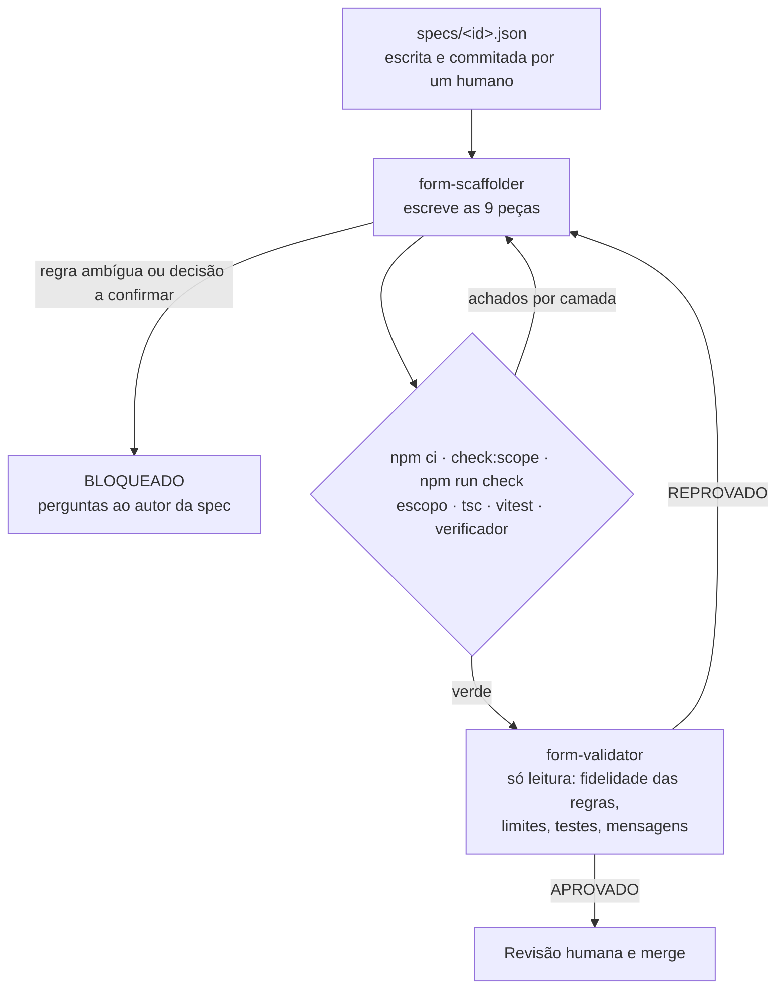

# form-scaffold-agents

Agentes do Claude Code que transformam a **spec declarativa de um formulário**
num **módulo completo da API, camada por camada**: schema, tipos, modelo,
mensagens, service, rotas, registro e testes. Um **verificador determinístico**
só aceita o módulo quando todas as camadas concordam com a spec.

O domínio de exemplo é a manutenção industrial: a inspeção preventiva de um
equipamento e o encerramento de uma ordem de serviço. São formulários com
dezenas de campos, seções, cálculos e regras condicionais ("se houve troca de
peças, descrição e foto são obrigatórias").

> **Origem.** A ideia nasceu num projeto privado da área de saúde, cujo
> objetivo era replicar prontuários eletrônicos: cada ficha clínica, com
> dezenas de campos e regras condicionais, virava um módulo num backend em
> camadas. Com agentes gerando as camadas e um verificador conferindo,
> colocar uma ficha nova no ar caiu de mais de um dia para cerca de uma hora.
>
> Este repositório reproduz o padrão num domínio neutro, de propósito: dados
> clínicos são sensíveis e as regras daquelas fichas pertencem ao projeto.
> Aqui não há código, dados nem regras de negócio de lá.

## Por que existe

Num backend em camadas, um formulário novo não é difícil, é **extenso**: o
mesmo campo precisa aparecer certo em oito ou nove lugares. O erro típico não
é de lógica, é de **deriva entre camadas**:
- a coluna que ficou `NOT NULL` com o campo opcional;
- a mensagem que fala "até 50 caracteres" com o schema dizendo 20;
- a regra sem teste.

Um agente escreve essas camadas rápido, mas "rápido" só vale se for confiável.
Por isso o projeto separa as responsabilidades:

- **A spec é de um humano.** Estrutura verificável + regras em linguagem
  natural.
- **O agente escreve o código.** É a parte que exige raciocínio: regras,
  cálculos, mensagens, testes de limite, aderência às convenções.
- **O verificador decide se está consistente.** Sem LLM: ele compara cada
  camada com a spec e exercita a API com o exemplo da spec.
- **Um segundo agente revisa o que o verificador não alcança**, e o merge
  continua humano.

## Como funciona



`/novo-formulario <id>` (`.claude/commands/`) orquestra o ciclo inteiro dentro
do Claude Code.

### As camadas de um formulário

| # | Arquivo | Conteúdo |
|---|---------|----------|
| 1 | `schema.ts` | `z.strictObject` com os campos + as regras em `withRules` (só rodam sobre estrutura válida) |
| 2 | `types.ts` | entrada, calculados e registro salvo |
| 3 | `model.ts` | tabela e colunas (`snake_case`, tipo, nulabilidade) |
| 4 | `messages.ts` | uma mensagem pt-BR por campo e por regra |
| 5 | `service.ts` | `compute` (cálculos, função pura) e `create` / `get` / `list` |
| 6 | `routes.ts` | `POST /`, `GET /`, `GET /:id` |
| 7 | `index.ts` | o `FormModule` exportado |
| 8 | `registry.ts` | o módulo registrado na API |
| 9 | `test/forms/<id>.test.ts` | um teste por regra, com o id no nome |

As convenções completas estão em [`playbook/camadas.md`](playbook/camadas.md).
O módulo de referência, escrito à mão, é
[`src/forms/inspecao-equipamento`](src/forms/inspecao-equipamento).

### O que o verificador confere

`npm run check:forms` lê os valores de runtime de cada módulo, sem
interpretar código-fonte:

| Camada | Verificação |
|--------|-------------|
| spec | schema da spec, nomes únicos, limites coerentes, exemplo válido |
| schema | `z.toJSONSchema(input)` contra a spec: campos, tipos, limites, obrigatórios, enum, entrada estrita, calculado fora da entrada |
| model | tabela, uma coluna por campo e por calculado, tipo e nulabilidade |
| messages | uma mensagem por campo e por regra, nenhuma sobrando |
| routes | `POST /`, `GET /`, `GET /:id` |
| registry | toda spec tem módulo e todo módulo tem spec, sem id nem recurso repetido |
| behavior | POST do exemplo → `201` e tudo de volta intacto, `GET` por id e na lista, `422` com a mensagem de cada obrigatório, recusa de campo desconhecido; texto em branco e lista vazia recusados pela própria estrutura |
| tests | cada regra tem um teste ativo com o id no nome (comentado, `skip`, `todo` não contam; `.only` reprova) |

Cada verificação tem um teste de mutação em `test/checker.test.ts`; as da spec
estão em `test/spec.test.ts`.

Fora do verificador, `npm run check:scope -- <id> --base <commit>` confere se,
desde o commit de onde a geração partiu, só mudaram a pasta do módulo, o teste
e o registro. Qualquer outro arquivo diferente da base reprova, commitado
depois ou não, novo, ou escondido por ignore ou por flag do índice. Antes dos
dois checks, o `/novo-formulario` faz `npm ci`, que restaura `node_modules/`.

Exemplo de saída para um módulo com três desvios:

```
✘ inspecao-equipamento
    [schema] field "codigoEquipamento": maxLength is 30 in the schema, 20 in the spec
    [model] column "itens_seguranca_pendentes" must be nullable
    [tests] no test names rule R3 (e.g. it('R3: ...'))
```

## Execução real registrada

O módulo [`ordem-servico`](src/forms/ordem-servico) **não foi escrito à mão**.
Ele foi gerado pelo `form-scaffolder` a partir de
[`specs/ordem-servico.json`](specs/ordem-servico.json): 15 campos, um campo
calculado e 5 regras.

| Etapa | Resultado |
|-------|-----------|
| `form-scaffolder` | 9 peças em cerca de 2,5 minutos, verde na primeira rodada, status `PRONTO` |
| Conferência independente | No commit gerado (`0742f9c`): `npm ci` → `check:scope --base 97aa481` ✔ → `npm run check`: tsc limpo, 62 testes, ✔ nos dois formulários |
| `form-validator` | **APROVADO**. Todas as mutações nas regras R1–R5 foram derrubadas pelos testes gerados; as que os testes não pegam são limites de campo, que o verificador pega |
| `/code-review` | 10 achados, nenhum que quebrasse o gate. Os relevantes estão abaixo |

O commit `feat(forms): ordem-servico, generated by form-scaffolder` traz o
módulo **exatamente como o agente entregou**. Os commits seguintes são a
resposta humana à revisão.

O que a revisão encontrou e o gate não alcança:
- **Uma decisão que deveria ter sido pergunta.** A spec dizia só "arredondado
  a 2 casas". O agente escolheu meio centavo para cima, anotou que um humano
  deveria confirmar e mesmo assim entregou `PRONTO`, quando o certo era
  `BLOQUEADO`. A spec passou a dizer o arredondamento, e o `form-scaffolder`
  ganhou a instrução: decisão a confirmar é pergunta.
- **Uma leitura possível, mas não a pretendida.** "Sem troca de peças, o custo
  não pode ser informado" deixava passar descrição e fotos de peças numa
  ordem sem troca. O agente seguiu a letra; o autor da spec a corrigiu.
- **Mensagens que se contradiziam.** O campo `diasAtraso`, exigido pela R1,
  dizia "ou omita o campo", e era o playbook que mandava. A convenção mudou,
  e o módulo de referência, que tinha o mesmo problema, também.
- **Dois erros para o mesmo campo** quando R2 e R3 se sobrepõem.

Na mesma execução, o `form-validator` afirmou que uma mutação de limite
(`horasTrabalhadas` com mínimo 0,45 em vez de 0,5) passava pelo verificador.
Reproduzida à parte, ela é pega:
`[schema] field "horasTrabalhadas": minimum is 0.45 in the schema, 0.5 in the spec`.
O relatório do revisor também é conferido, não aceito como está.

Esse é o ciclo que o projeto quer mostrar:
- o agente produz;
- o determinístico confirma o que é verificável;
- a revisão encontra o resto;
- o que a revisão encontra vira regra: no gate, quando dá para verificar por
  código; no playbook ou no agente, quando não dá (decisão 12).

## Uso

```bash
npm install            # Node 22 ou mais recente
npm run check          # typecheck + testes + verificador
npm start              # API em http://localhost:3000
```

```bash
curl -s localhost:3000/forms
# [{"id":"inspecao-equipamento",...},{"id":"ordem-servico",...}]

# O exemplo da própria spec: 201, com o custo total calculado (R4)
jq .example specs/ordem-servico.json | curl -s localhost:3000/ordens-servico \
  -H 'content-type: application/json' -d @-
# {"id":"...", ..., "cobertura":"avulsa","custoTotal":800.5}

# Garantia com valor da hora: 422, recusado pela R3
curl -s localhost:3000/ordens-servico -H 'content-type: application/json' -d '{
  "codigoEquipamento": "CMP-0042", "numeroOrdem": "OS-2026-0190", "dataEncerramento": "2026-11-12",
  "tecnico": "Equipe de manutenção", "concluidaNoPrazo": true, "equipamentoLiberado": true,
  "houveTrocaPecas": false, "horasTrabalhadas": 2, "valorHora": 120, "cobertura": "garantia"
}'
# {"errors":[{"field":"valorHora","message":"Na garantia, omita o custo das peças e o valor da hora;
#   na cobertura avulsa, informe o valor da hora.","rule":"R3"}]}
```

### Um formulário novo

1. Escreva `specs/<id>.json`, com o `example`, revise e **faça commit**. A
   geração parte de uma árvore limpa, e a spec é de um humano.
2. No Claude Code, dentro do repositório: `/novo-formulario <id>`.
3. Revise o diff e o resumo (regra → código → teste) e faça o merge.

## Estrutura

```
specs/                 specs dos formulários (fonte da verdade)
src/spec/              formato da spec, carga e schema estrutural de referência
src/core/              modelo, repositório, validação, app HTTP
src/forms/<id>/        um módulo por formulário
src/checker/           verificador entre camadas, verificação de escopo e CLIs
playbook/camadas.md    convenções que o agente segue
.claude/agents/        form-scaffolder e form-validator
.claude/commands/      /novo-formulario
```

## Limites conhecidos

- O `check:scope` protege contra erro e descuido do gerador, não contra um
  agente que tente sabotar as ferramentas na mesma máquina. Contra este, a
  defesa é isolamento: agente em container e gate num checkout limpo, como em
  [evidence-gated-agent](https://github.com/marcosrebelo97/evidence-gated-agent).
- O verificador não julga se uma regra está certa, só exige que ela tenha
  teste. A fidelidade é trabalho do `form-validator` e da revisão humana
  (decisão 6).
- Valores em reais aceitam frações de centavo na entrada (`0.001`); só o
  calculado é arredondado. Resolver pede casas decimais na spec e no
  verificador.
- Sem autenticação: é uma demonstração. Por isso a API escuta só em
  `127.0.0.1`; `HOST=0.0.0.0` a expõe.
- Repositório em memória. Trocar por Postgres é implementar `Repository`.
- Sem migração entre versões de formulário.

As decisões de projeto, com o porquê e o que ficou de fora, estão em
[DECISIONS.md](DECISIONS.md).

## Trabalhando neste repositório com IA

Os agentes de `.claude/` são o produto: geram e revisam formulários. A
manutenção do resto (core, verificador, CI) também é feita com o Claude Code,
e quem a governa é o [`CLAUDE.md`](CLAUDE.md): os invariantes que não podem
regredir, como "quem gera não altera o gate", e a exigência de teste de
mutação para qualquer mudança no verificador. Os dois são versionados de
propósito: fazem parte de como o projeto é mantido.

## Licença

MIT
